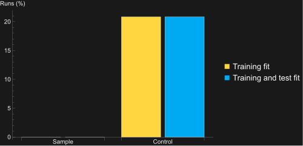
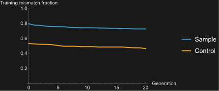
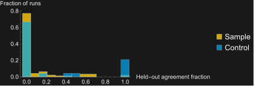

# OEIS sequence-discovery pilot

Sequence data come from [WolframInstitute/OEIS](https://github.com/WolframInstitute/OEIS),
as requested. This pilot measures the current evolutionary search on a frozen
subset, with a training prefix and later terms withheld until final evaluation.
The [computational essay](../en/Tutorials/MeasuringOEISSequenceDiscovery.md)
contains executable analysis, five scientific figures and the complete trial
function. Dataset and result files are in
[`Recursor/Assets/Benchmarks/OEIS`](../../Recursor/Assets/Benchmarks/OEIS).

The [full-corpus experiment protocol](OEISCorpusExperiment.md) extends this
pilot with complete corpus coverage, additional seeds, mutation comparisons
and standalone WL program exports.

## Source and selection

- Repository revision: `d82309e7f1436b641490aa8abf426c39e0d158a7`.
- Its `oeisdata` submodule revision: `69c667df437a093151042e2cbec1f1198e70765a`.
- The pinned sequence tree contains directories A000 through A393.
- A complete local checkout contains 393,450 sequence records. Every file was
  checked against its Git blob hash, and all numeric terms and offsets parsed.
  The eligibility rule below admits 283,167 records. `Snapshot.json` preserves
  the corpus count, integrity digest and eligibility counts.
- Enumerate A000000 through A393999 and sort by the SHA-256 bytes of
  `Recursor-OEIS-pilot-v1:` followed by the A-number.
- Visit that order, exclude the eight named controls, and retain the first
  32 eligible entries. Eligibility requires the `nonn` keyword, a nonnegative
  first offset, at least 20 integer terms, no negative recorded term, and
  neither `dead` nor `full`. Forty-three IDs were examined; eleven were excluded.
- The manifest preserves the selected order, excluded IDs and reasons,
  original offset, first 20 terms, source URLs and source SHA-256 hashes.
- Selecting from the complete local corpus reproduced the same 32 sampled
  entries, and all 40 pilot records matched their recorded source hashes.
- Controls, reported separately: A001477, A000290, A000217, A000079,
  A000045, A000120, A000142 and A000578.

The actual `Kernel/OEISParser.wl` from the pinned repository was loaded in
Wolfram Language. Its ``OEIS`OEISParser`ParseOEISSeqFile`` function independently
agreed with every selected sequence's ID, first offset and first 20 terms.
The parser's SHA-256 is recorded in `Results.json`.
`PureFunction`, formulas, names and enrichment comments were not passed to
the search. No external model or enrichment service was used.

## Protocol

Each of 40 sequences has three runs using seeds 9101, 9102 and 9103.
The first eight terms are training examples; the next twelve are test terms.
Inputs are the original consecutive OEIS indices, not positions reset to zero.
The test terms are inspected only after selecting a run's final program.

Settings: population 24, 20 generations, two elites, tournament size 3,
crossover probability 0.8, mutation probability 0.3, initial depth 2,
replacement depth 3, maximum 60 nodes, generated constants 0 through 3,
and `IncludeWhile -> True`. The initial population is generated randomly;
there are no supplied example programs or proposer callback. Stopping on a
training fit is disabled. Each run proposes 464 individuals, including the
initial population; identical source programs share a training-score cache
within that run.

Each evaluation is limited to 2000 syntax visits, 0.1 seconds and 64 MiB of
additional memory. Search fitness is the number of exact training matches;
size breaks ties. A failed evaluation contributes no match. Training loss is
`1 - fitness/8`, so it is an exact-mismatch fraction rather than a regression
error. Test agreement is the fraction of twelve exact matches. Final training
and test checks preserve each input, expected value, returned value or failure
tag, and match flag. Exhaustion is never labeled nontermination.

## Recorded observations

The corrected run used Recursor commit
`4a708300bdfcdb39dc3c2fc55a03b10b03986279`. Machine, Wolfram version, source
revisions, UTC timestamps and cohort hash are recorded in `Results.json`.

| Observation | Hash-selected sample | Named controls |
| --- | ---: | ---: |
| Sequences | 32 | 8 |
| Runs | 96 | 24 |
| Runs fitting all training terms | 0 | 5 |
| Runs fitting all training and test terms | 0 | 5 |
| Sequences with at least one complete fit | 0 | 2 |
| Mean initial training mismatch | 79.43% | 53.13% |
| Mean final training mismatch | 72.53% | 46.35% |
| Mean held-out term agreement | 8.68% | 25.35% |



The two completely fitted controls are the nonnegative integers, A001477
(three seeds), and squares, A000290 (two seeds). The five training fits all
extend across their test windows, but this tiny conditional sample contains
only those two familiar sequences. It is not evidence of broad generalization.
The sample has no training fits, so its generalization rate conditional on a
training fit cannot be estimated from this experiment.
Two sample runs match all test terms while missing one training term; they
are not counted as successful sequence discoveries.





Of 1440 final test evaluations, 1434 completed and six reached the step limit.
There were no final test time or memory failures. All 120 searches completed
without Wolfram messages, and all reported final training scores agreed with
independent reevaluation. Total search time was about 102.53 seconds, excluding
acquisition, final checks and report rendering. This is a measured runtime
for this machine and protocol, not a speed comparison.

The complete 120-trial study was then repeated through the trial function
displayed in the essay. All recorded fields agreed except the expected
wall-clock timings. All 18 ordinary essay inputs evaluated without messages.

The original pilot exposed a genuine evaluator bug: the host `Do` and `Nest`
constructs reject iteration counts beyond a machine integer, and `Iter` or
`Rec` could then return their initial value. Explicit counters now let Recursor's
own budget terminate these computations. Three regression tests cover the
large-count cases. All 192 tests passed before the complete pilot was rerun
with unchanged data, seeds and search settings. The original, invalid run is
kept only under ignored `build/oeis-benchmark/before-large-count-fix`.

## Reproduce

Load a source checkout containing this essay and its data files. The recorded
kernel revision identifies the evaluation and search implementation used. The
computational essay
reads `Cohort.json` and `Results.json` from the paclet's Assets directory and
plots the recorded observations without a network request. Evaluate its final
120-trial expression explicitly to repeat the searches. Timing and time-limit
outcomes can vary with hardware and the Wolfram version.

To audit the dataset, obtain the pinned WolframInstitute/OEIS repository,
download each manifest entry's `SourceURL`, compare its SHA-256, and call the
repository's ``OEIS`OEISParser`ParseOEISSeqFile`` on those files. There is no need
to build all of `Data/`, initialize jOEIS or execute generated programs.
Raw files and acquisition metadata for this run are under ignored
`build/oeis-benchmark`. The permanent manifest carries the selected targets,
full protocol and exclusions so reproduction does not depend on that cache.

For a complete local copy of the raw sequence snapshot, clone the source
repository and initialize its pinned `oeisdata` submodule:

```sh
git clone --filter=blob:none https://github.com/WolframInstitute/OEIS.git OEIS
git -C OEIS checkout d82309e7f1436b641490aa8abf426c39e0d158a7
git -C OEIS submodule update --init --depth 1 oeisdata
```

Each sequence is then available offline as
`OEIS/oeisdata/seq/Axxx/Axxxxxx.seq`. Load `OEIS/Kernel/OEISParser.wl` and use
``OEIS`OEISParser`ParseOEISSeqFile`` to read an individual record's `Sequence`
and `Offset`. This downloads the terms stored in the sequence records; linked
b-files containing further terms are separate resources. The full corpus
stays outside the Recursor repository and paclet archive. The audit and
eligibility index for the local checkout are in `OEIS/build/recursor`.

Sequence data retain [CC BY-SA 4.0](https://creativecommons.org/licenses/by-sa/4.0/)
attribution to the OEIS Foundation and contributors. See the packaged
[NOTICE](../../Recursor/Assets/Benchmarks/OEIS/NOTICE.md).

## Limits and next comparisons

This is a small-budget pilot of the complete evolutionary search. It measures
neither a success rate across all OEIS sequences nor the separate contribution
of mutation. The sample excludes negative outputs, negative offsets, records
marked `dead` or `full`, and short records. The `fini` keyword alone does not
exclude an entry. The controls are deliberately selected examples,
not a random sample. Scores over related sequences and repeated seeds are not
independent observations. Agreement on a finite test window is not a proof of
the discovered program's infinite behavior.

A stronger follow-up should add independent test cohorts and matched-budget
random-search, mutation-only and crossover-only arms, then compare sequence
fitting built-ins under explicit budgets. Changes to the generator, operator
probabilities, fitness, constants or grammar should be tuned on a separate
development cohort, not on these held-out terms.
