# Recursor on OEIS: what 9,110 training fits predict

**Checkpoint: 6 November 2026, 10:26:05 EAT (07:26:05 UTC).** The workers continued while this fixed interim report was prepared.

[Mathematica notebook](../../notebooks/RecursorOEISMeasurements-01.nb) · [All programs, sequences and WL functions](data/OEISMeasurements9110.json.gz) · [Numerical results](data/OEISMeasurements9110-metrics.json) · [Reproduction archive](data/OEISMeasurements9110-reproduction.zip)

## Results

**9,110 entries have an eight-term training fit; 897 also pass the twelve-term test; 91 match every recorded term.** These are finite prediction checks, not proofs of infinite sequence identities.

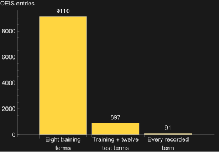

*Figure 1. Of 9,110 programs that match the first eight terms, 897 match the next twelve and 91 match every stored term.*

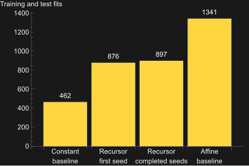

*Figure 2. Of 283,167 eligible sequences, Recursor matches the first twenty terms for 897; a straight-line formula matches 1,341.*

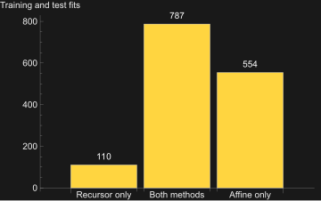

*Figure 3. Recursor matches 110 sequences missed by the straight-line baseline, but matches fewer sequences overall.*

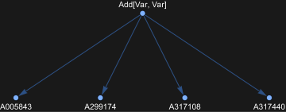

*Figure 4. One program, `2 n`, matches every stored term of four different OEIS entries.*

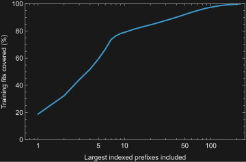

*Figure 5. The 9,110 fits contain only 221 different combinations of starting index and first eight terms.*

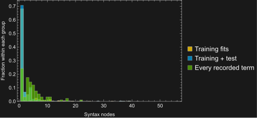

*Figure 6. Program sizes for training fits, programs matching the next twelve terms, and programs matching every stored term.*

## Programs that match every recorded term

These ten examples match every stored term of their sequences. The line shows OEIS values and the points show Recursor predictions; vertical lines mark the end of training and the twelve-term test. Each example includes a standalone WL function and its compiled lambda tree.

The lambda trees show the compiled functions before reduction, using [Wolfram/Lambda](https://resources.wolframcloud.com/PacletRepository/resources/Wolfram/Lambda/). Pink nodes bind variables, gray nodes apply functions, and blue nodes refer to variables. Dense trees omit labels to avoid overlap.

```wl
polynomialProgram = Mul[Add[Succ[Var], Const[2]], Var];
```

```wl
roundedArithmeticProgram = Monus[Succ[Pred[Var]], Half[Half[Pred[Var]]]];
```

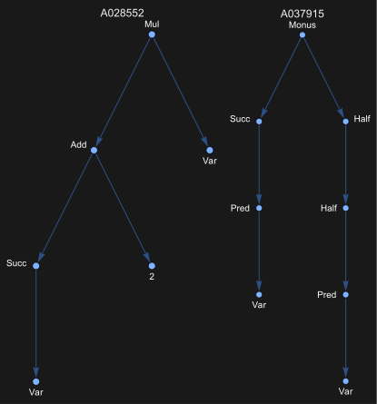

*Figure 7. Program trees for A028552, `n (n + 3)`, and A037915, `Quotient[3 n + 4, 4]`.*

```wl
a028552[n_] := n (n + 3)
```

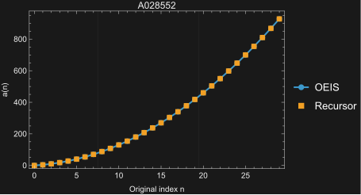

*Figure 8. A028552: `n (n + 3)` matches all 51 stored terms; the first 30 are shown.*

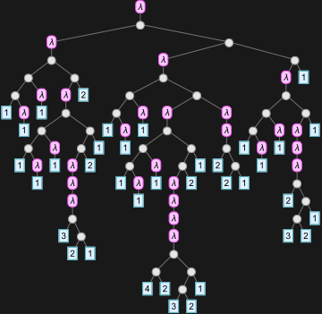

*Figure 9. Compiled lambda tree for A028552: `n (n + 3)`.*

```wl
a037915[n_] := Quotient[3 n + 4, 4]
```

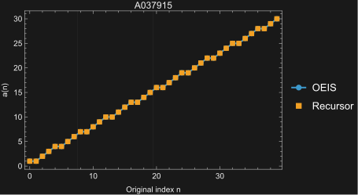

*Figure 10. A037915: `Quotient[3 n + 4, 4]` matches all 73 stored terms; the first 40 are shown.*

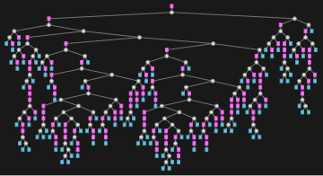

*Figure 11. Compiled lambda tree for A037915: `Quotient[3 n + 4, 4]`.*

```wl
squareProgram = Mul[Var, Var];
```

```wl
a000290[n_] := n^2
```

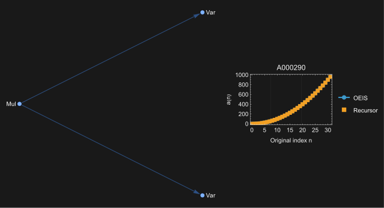

*Figure 12. A000290: squares, `n^2`. All 51 stored terms match; the first 32 are shown.*

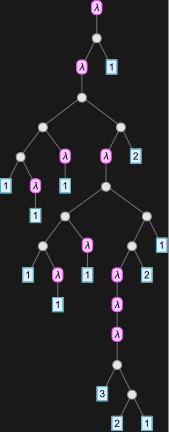

*Figure 13. Compiled lambda tree for A000290: `n^2`.*

```wl
cubicProgram = Mul[Mul[Var, Var], Mul[Var, Const[3]]];
```

```wl
a117642[n_] := 3 n^3
```

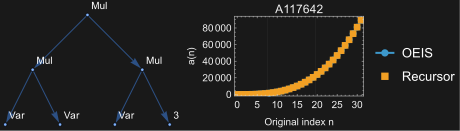

*Figure 14. A117642: `3 n^3`. All 40 stored terms match; the first 32 are shown.*

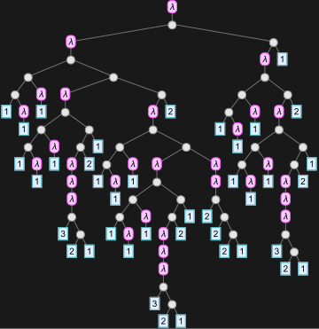

*Figure 15. Compiled lambda tree for A117642: `3 n^3`.*

```wl
roundedProductProgram = Mul[Mul[Var, Half[Var]], Half[Var]];
```

```wl
a122656[n_] := n Quotient[n, 2]^2
```

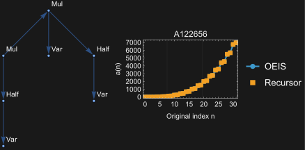

*Figure 16. A122656: `n Quotient[n, 2]^2`. All 46 stored terms match; the first 32 are shown.*

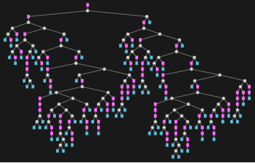

*Figure 17. Compiled lambda tree for A122656: `n Quotient[n, 2]^2`.*

```wl
skipMultiplesProgram = Add[Half[Pred[Var]], Var];
```

```wl
a001651[n_] := n + Quotient[Max[0, n - 1], 2]
```

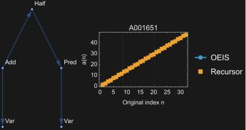

*Figure 18. A001651: positive integers that are not multiples of three. All 70 stored terms match.*

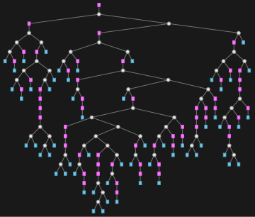

*Figure 19. Compiled lambda tree for A001651: `n + Quotient[Max[0, n - 1], 2]`.*

```wl
periodicProgram = Rem[Half[Var], Const[3]];
```

```wl
a131555[n_] := Mod[Quotient[n, 2], 3]
```

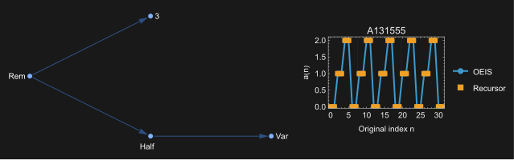

*Figure 20. A131555: the block `0, 0, 1, 1, 2, 2` repeats. All 105 stored terms match.*

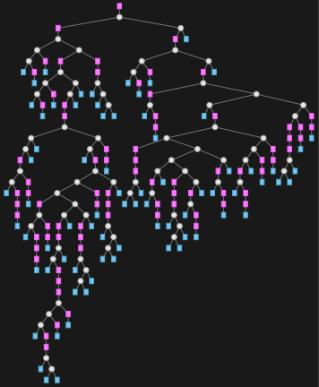

*Figure 21. Compiled lambda tree for A131555: `Mod[Quotient[n, 2], 3]`.*

```wl
residueProgram = CoRec[Const[3], Rem[Var, Idx]];
```

```wl
a010872[n_] := Mod[n, 3]
```

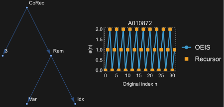

*Figure 22. A010872: remainders after division by three. All 105 stored terms match.*

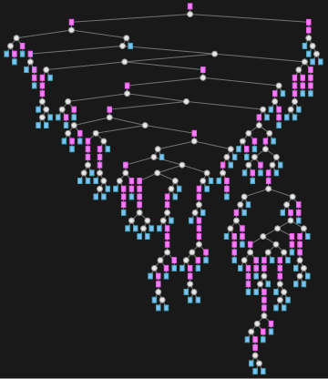

*Figure 23. Compiled lambda tree for A010872: `Mod[n, 3]`.*

```wl
conditionalProgram = Ifz[Pred[Var], Const[0], Succ[Var]];
```

```wl
a114637[n_] := If[n < 2, 0, n + 1]
```

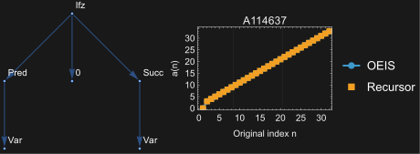

*Figure 24. A114637: `0, 3, 4, 5, ...`. All 73 stored terms match.*

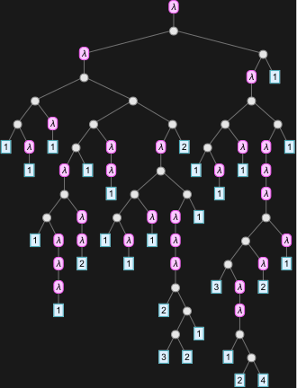

*Figure 25. Compiled lambda tree for A114637: `If[n < 2, 0, n + 1]`.*

```wl
residueClassProgram = Add[Half[Pred[Var]], Add[Half[Half[Pred[Var]]], Var]];
```

```wl
a047380[n_] := n + Quotient[Max[0, n - 1], 2] + Quotient[Max[0, n - 1], 4]
```

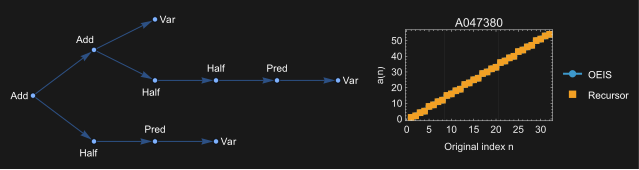

*Figure 26. A047380: positive integers with remainder 1, 2, 4 or 5 on division by seven. All 64 stored terms match.*

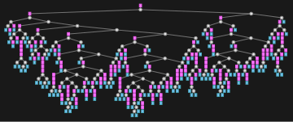

*Figure 27. Compiled lambda tree for A047380: `n + Quotient[Max[0, n - 1], 2] + Quotient[Max[0, n - 1], 4]`.*

## Where does mutation come from?

[MutateRecursor](https://github.com/WolframInstitute/Recursor/blob/e7786c8b9200a308e495a91e6bb66000d0fa0462/Recursor/Kernel/Evolution/Operators.wl) is a handwritten grammar operator: choose a syntax node uniformly, generate a replacement using its available bindings, and check scope and size. This run uses replacement depth three and at most sixty nodes; mutation calls do not invoke Lean or mathlib.

```wl
parent = Rec[Var, Const[1], Mul[Succ[Idx], Acc]];
```

```wl
mutant = BlockRandom[SeedRandom[2]; MutateRecursor[parent, 3]];
```

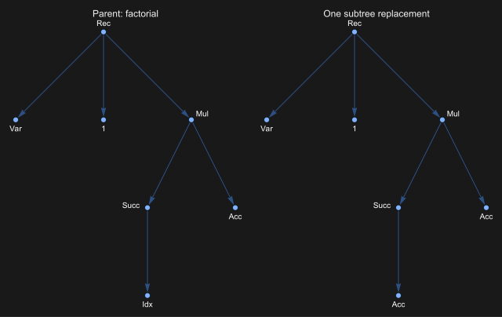

*Figure 28. Replacing `Idx` with `Acc` changes factorial into `a(0) = 1, a(n+1) = a(n) (a(n)+1)`; this is a separate example.*

## What are the loss curves like?

Loss is `1 - exact training matches/8`: zero means all eight training terms match, 0.125 means seven match, and one means none match. It measures exact agreement, not how close a wrong number is to the correct one. Each curve tracks the best training score so far; a downward-only curve is expected because that best score is retained.

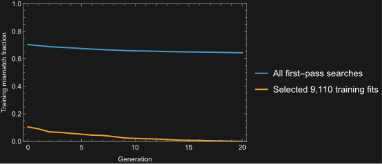

*Figure 29. Average training loss for all first searches (blue) and only the successful training fits (orange).*

**The broad search improves modestly:** mean loss falls from 70.45% to 64.43%, equivalent to increasing the average number of correct training terms from 2.36 to 2.85 out of eight. The orange curve ends at zero because it includes only eventual training fits; it cannot establish that the search usually succeeds.

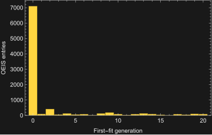

*Figure 30. 7,107 of the 9,110 selected runs already match all eight training terms before evolution starts.*

Generation zero is the population of 24 randomly generated programs, before mutation or crossover. **Most selected training fits therefore already have a fitting candidate before evolution begins**, although evolution can subsequently find another fitting program or reduce its size. The later 2,003 fits cannot be credited specifically to mutation without a comparison that removes it.

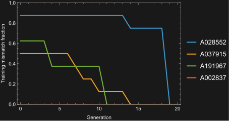

*Figure 31. Three runs find a complete training fit later; A002837 already fits at the start.*

Flat portions mean the best exact-match count stays unchanged; a drop of 0.125 means one additional training term matches. A028552's final drop adds six matches at once. Only generation boundaries were recorded, so the connecting lines do not show every candidate or identify which operator caused an improvement.

**Lower training loss is not yet evidence of discovering the sequence rule.** A002837 has zero training loss but fails at its 42nd recorded term. Of all 9,110 training fits, only 897 pass the next twelve terms and 91 match every recorded term. On the matched 2,048-entry control, evolution and evolution without mutation each achieve eight primary successes, versus nine for random search. Thus these curves show training progress and some predictive programs, but do not yet demonstrate a generalization advantage from mutation. Held-out terms were checked only for final selected programs, so there is no measured test-loss curve over generations.

## How successful is generalization?

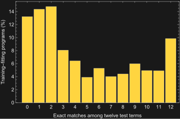

*Figure 32. How many of the next twelve terms each program gets right; 897 programs get all twelve right.*

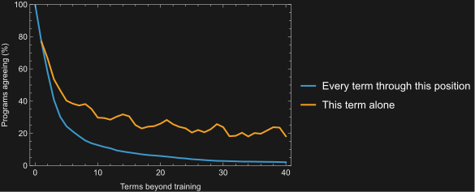

*Figure 33. The same 7,840 programs predict farther into their sequences; the blue line requires every preceding prediction to match.*

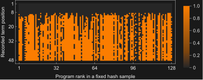

*Figure 34. Each column is a program and each row a sequence position; 0 means a match, 1 a wrong or unfinished prediction.*

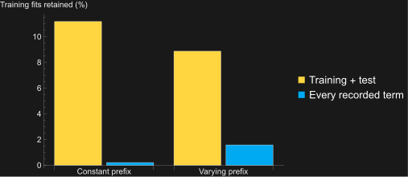

*Figure 35. How often programs trained on constant or changing terms also match later terms.*

**179 of 109,320 primary-test evaluations hit the step budget.** Ten candidate programs fail this test solely through unfinished evaluations, without an observed wrong value; budget exhaustion does not prove nontermination.

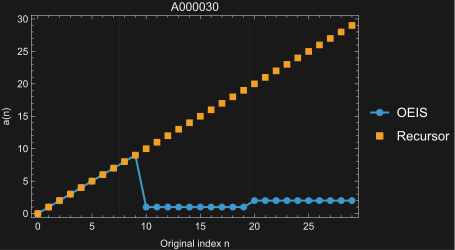

*Figure 36. A000030: `n` matches the first ten terms, then predicts 10 where the next value is 1.*

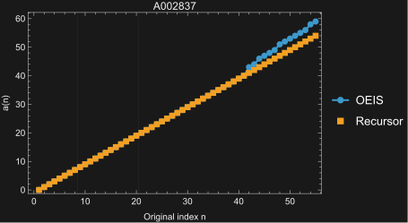

*Figure 37. A002837: `n - 1` matches 41 terms, then predicts 41 where the next value is 43.*

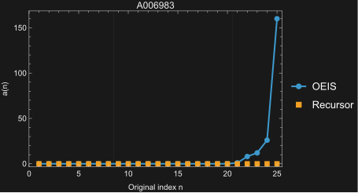

*Figure 38. A006983 begins with twenty zeros, but its next term is 1; a constant-zero program fails there.*

## Does mutation or a larger search help?

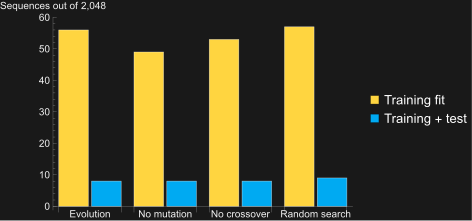

*Figure 39. Evolution matches all twenty terms for eight of 2,048 sequences; without mutation it still matches eight, and random search matches nine.*

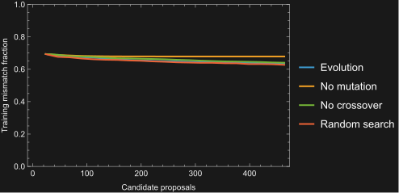

*Figure 40. Training loss across methods given 464 candidate programs each.*

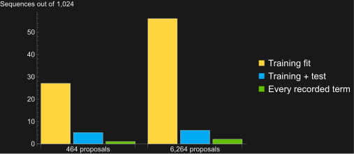

*Figure 41. A larger search improves the fit to the first eight terms much more than its predictions of the next twelve.*

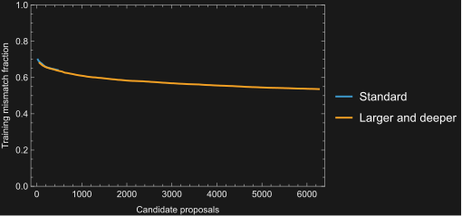

*Figure 42. Extra search lowers training loss, but does not by itself show better predictions.*

## Measurement and reproduction

The [frozen protocol](OEISCorpusExperiment.md) defines eligibility, search budgets, seeds and controls. Of 393,450 source records, 283,167 qualify. Search sees only eight training terms at their original indices; names, formulas, existing WL code and test terms are withheld. Selection uses rechecked training accuracy, then smaller programs, then lower seeds.

The complete first seed produced 8,626 training fits, 876 primary successes and eighty all-recorded successes; three searches timed out. The headline 9,110/897/91 includes a partially completed second seed, with 283,165 entries having a completed candidate. The four-method comparison uses 2,048 matched entries and excludes the forty pilot IDs. Each method tries 464 programs, but random search samples depth three while evolution starts at depth two. The larger-search control changes both program depth and the number of candidates, so it does not isolate either effect. These counts measure this search at its recorded budget, not the language's expressive limit or a speed advantage over WL methods.

Mathematica 15.0.0 computed all statistics and 42 figures; the lambda trees use Wolfram/Lambda 1.2.6. The notebook contains editable graphics and executable Input cells; its closed initialization section imports the fixed data without restarting the search. The compressed records preserve all 9,110 programs, sequences, loss histories, per-term checks and standalone WL functions, plus the matched comparisons. Every WL function agrees with all completed Recursor outputs; “compact” means the shortest verified candidate among the implemented translations, not global minimality.

Recursor revision: `e7786c8b9200a308e495a91e6bb66000d0fa0462`. [OEIS snapshot](https://github.com/WolframInstitute/OEIS/tree/d82309e7f1436b641490aa8abf426c39e0d158a7), data revision: `69c667df437a093151042e2cbec1f1198e70765a`. Exact cutoff: `2026-11-06T07:26:05.809007+00:00`. Report-data SHA-256: `1fd52993f55048d6b2f73503869538bc3797b5f100e125c9df398b1780183096`.

Sequence data are © the OEIS Foundation Inc. and contributors, under [CC BY-SA 4.0](https://creativecommons.org/licenses/by-sa/4.0/); this report, derived data and figures use the same license. Recursor and reproduction code use MIT. The [report archive](data/OEISMeasurements9110-reproduction.zip) contains its generators; the [experiment archive](OEISCorpusExperiment.zip) contains the frozen search runners. The notebook uses standard Wolfram input, output and text styles, with native graphs and trees.
